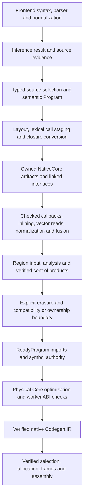

# Compiler structural checkpoint

Date: 2026-10-26. Scope: the user's amended structural acceptance criteria in
[the cleanup register](2026-10-25-COMPILER-CLEANUP.md#acceptance-amended-by-the-user-2026-10-26).
Performance tuning, exhaustive migration and hosted CI repairs are follow-up
work. This document describes the current compiler, rather than the original
review's proposed final architecture.

## Current pipeline

Frontend responsibilities live in `Frontend.Syntax`, `Lexer`, `Parser`,
`Normalize`, `Desugar.Typed`, `Linearity`, `Paths` and `Diagnostics`.
`FPRISC` and `Frontend.Desugar.Checked` are compatibility facades.
`Type.Syntax`, `Ownership.Shape` and `Core.Identity` own the shared vocabularies.

`Core.Typed.Program` retains checked declaration schemes, physical arities,
recursive assumptions and lexical identities. `Core.Typed.Pipeline` publishes
opaque `ClosedProgram` products, verifies scope/type/shape/code contracts and
keeps original source interfaces authoritative. Native artifacts retain this
product alongside an explicit erased projection; the latter is not presented
as preserved typing evidence.

`Compiler.Native.Linked` validates symbol/code homes and imported private
contracts. `Compiler.Native.Regions` owns its input, context, analysis and
result products; `Regions.Typed` retains checked control/helper interfaces.
`Compiler.Native.Imports.ReadyProgram` owns prepared emission/import authority.
`Core.Opt.Pipeline.OptimizedCore` owns physical Core, worker signatures and
named pass reports, with retained-entry/worker ABI checks.

`Compiler.Options` owns codegen, native, diagnostic and driver options and their
cache identity. `Diagnostic.Syntax` and `Source.Span` own shared diagnostic and
location data. Native calling/entry contracts, symbol roles, ISA opcode ADTs,
instruction annotations and column/record/layout kernel plans have their own
typed owners. `Codegen` is a backend driver; `Codegen.IR`/`Eval` and runtime
primitives define semantics. Native emission uses `emRefusals`; it cannot fall
back to a retired generator.

## Checked fusion

`Core.Typed.Fusion` composes adjacent/nested map and filter callbacks before
region placement and erasure. Composites carry fresh code/binder identities,
checked occurrence types and capture schemes. Original private code stays at
its home; composites call it through explicit contracts. Literal, lexical and
stored-value captures are staged without replaying effectful stored arguments.
Long chains reach a fixed point. Fresh display spellings protect the remaining
compatibility printer when pure prefix bindings broaden their scope.

`FusionSafety` summarizes checked expressions/code identities against one
shared linked-program snapshot. It rejects observable callbacks, division,
unknown calls, recursion without termination evidence, direct traps and
refutable let patterns. Unreachable match
fallbacks are identified by their match position, not by `Generated` origin.
The existing Int-overflow relaxation is shared with the compatibility pass in
`Core.FusionPolicy`. Refusal notes are structured until rendering.

Checked owners bypass erased callback composition. The remaining physical
pipeline canonicalizer still operates on erased Core; explicit compatibility
definitions retain their old fusion path. Vector producers remain explicit
inputs for fusion and physical planning. ARC/raw retain their existing owner.
Codegen revision **124** versions changed optimization products and QOS
admission stamps; source/Core Binary formats and runtime/physical ABIs remain
unchanged.

## Structural acceptance audit

| Amended criterion | Current evidence |
|---|---|
| Separate responsibilities/readable pipeline | Frontend facade/owners, `Compile`'s named checked stages, native artifact/region/import owners and `Core.Opt.Pipeline` |
| Preserve evidence through main semantic transformations | Opaque typed Program/ClosedProgram, checked callback/inlining/vector/normalization/fusion products, complete graph verification and source-interface checks |
| Make remaining boundaries explicit | NativeCore's compatibility reasons/projection, checked ARC representation signatures, region/import products and physical OptimizedCore/worker ABI reports |
| Shared typed options/diagnostics/principal native contracts | Compiler.Options, Diagnostic.Syntax/Source.Span, Codegen.Call/Calling/Symbol/Opcode/Selected and checked kernel-plan owners |
| Focused correctness validation | Compiler build; typed-program and kernel invariants; original fusion/inlining/vector-read jobs; end-to-end typed-Core, mixed-pipeline and native/emission checks described below |
| Documentation and delivery | This current pipeline record, amended acceptance register, explicit follow-up list, and the commit containing these changes synced to main |

## Focused validation

The compiler builds with `make fpr`. Typed-program checks cover generated
composite answers through the independent native-IR evaluator, fresh/stable
identities, polymorphic captures, long/computed chains, strict stored effects,
generated-trap refusal, refutable patterns, source fallbacks and fixed points.
Recursive callbacks are conservatively refused without termination evidence.
Kernel checks exercise checked plan admission/refusal and the renamed emission
API. The physical pipeline regression proves checked definitions bypass erased
callback composition while compatibility definitions still use it.

The original four focused Base jobs pass: Core pipeline, vector fusion,
inlining and vector reads. They retain effect/failure ordering, the refusal
diagnostic, pure F64/Int fusion and the 96-versus-96,096-byte vector-read check.
No assertions or timeout limits were relaxed.

End-to-end typed-Core checks pass for scopes/types/ownership, closure and join
contracts, private imports/code identity, cache transitions, source traps and
native one/four-hart values; nonhost targets have emission/available assembler
coverage. Mixed pipelines pass all existing control combinations, captures,
stable compaction, F64/F32 values, seed/effect/trap order and RV32/RV64 emission.

After the final safety/API changes, the new fusion fixture separately passes
**16 native executions and eight target emissions**: map/filter composites,
captured/computed chains and once-only stored captures, with fusion/inlining
independently on/off and one/four harts. Sol argv/shared-language checks pass.
Fresh-cache QOS host/application/plugin rebuilds also pass ordinary admission
and malformed executable-page-range refusals after the cache revision change.
Emission is not nonhost or physical-board execution proof. No new full Base
sweep, benchmark campaign or hosted-green claim is made for this checkpoint.

Local records: `/private/tmp/fpr-typed-fusion-build-final.log`,
`/private/tmp/fpr-typed-fusion-unit-final.log`,
`/private/tmp/fpr-typed-fusion-kernel-final.log`,
`/private/tmp/fpr-typed-fusion-focused.log`,
`/private/tmp/fpr-typed-fusion-native.log`,
`/private/tmp/fpr-typed-fusion-pipelines.log`,
`/private/tmp/fpr-typed-fusion-smoke.{py,log}` and
`/private/tmp/fpr-typed-fusion-sol-final.log` and
`/private/tmp/fpr-typed-fusion-qos-final.log`.

## Explicit follow-up work

- Move the remaining physical layout temporaries, mixed-pipeline
  canonicalization, ARC/raw ownership rewrite, worker creation and constructor
  reuse onto richer checked representations when needed. Their existing named
  boundaries remain; they are not fully typed semantic transformations yet.
- Improve compilation/runtime performance, code placement, allocation behavior
  and redundant strict closure construction; expand benchmark evidence later.
- Repair and refresh GitHub CI separately. Prior green checkpoints remain
  historical evidence; they do not certify the current tree.
- Extend diagnostic producer coverage/full parser ranges and finish remaining
  source/data/linker payload contracts and compatibility-name cleanup.
- Runtime memory-model redesign, allocator quality, new foreign ABIs and
  physical-board qualification remain separate projects.
