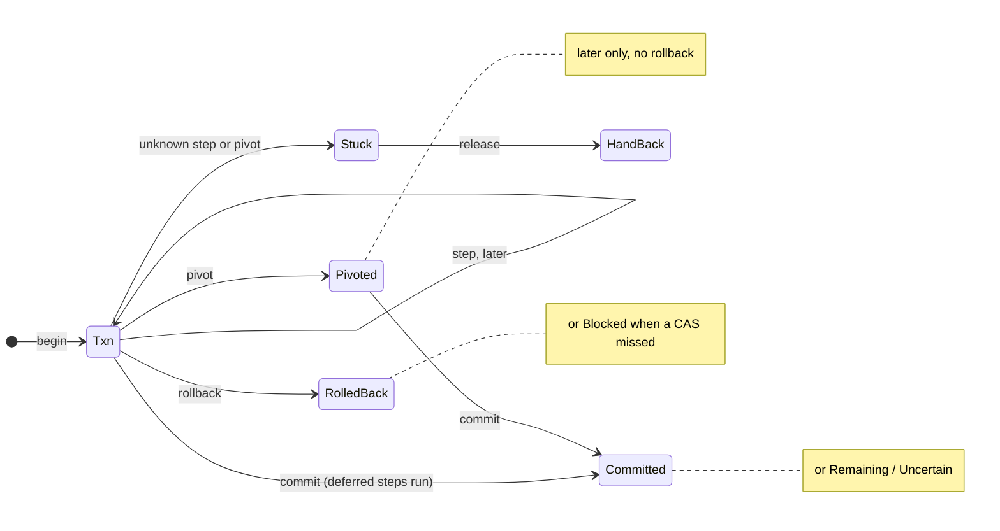

# Txn: a linear transaction type for FP-RISC and QOS

Date: 2026-10-29. Kind: proposal, not implemented. Applies to fprisc
`0be0c9d` and qos `8ba7cbf`; every line number below was read at those
revisions. Nothing here has been compiled.

## Summary

Add `std/txn.fpr`: a linear `Txn 1 s j d` that wraps any state `s` and is
driven by a `Resource s j d` record of functions, the same shape as
`Backend s` in `std/transport.fpr`. Every forward step returns its own undo
token `j` as data; deferred steps `d` run only at commit; one irreversible
step (a pivot) changes the type to `Pivoted`, which has no rollback. A step
whose outcome is unknown latches the transaction instead of guessing.

Why now: the two repos hand-roll pieces of this in about 25 places, with a
different failure rule in each. Three of them are real undo logs (the Git
reference CAS, `spawnHeap` admission, the `logic.sol` trail). The recurring
bugs are the ones a typed journal removes: a relative undo
(`Mod.detachLast`), an append result dropped on the floor (QOS `pos1`), and
a model adopted before its write is known to have landed (`std/store`,
`std/live`).

What it does not claim:

- **No isolation.** Compensation is visible to other actors, as
  `SOL-EFFECTS` §4 already says.
- **No atomicity the resource lacks.** `Txn` sequences and undoes; a single
  durable commit point still has to come from the storage layer (QLOG,
  `writeAtomic`).
- **Not a replacement** for Sol's whole-script file transaction
  (`compiler/Sol/Txn.hs`). It is the library form of the same vocabulary,
  usable in every profile.
- **Not compiled.** The code below was checked against
  `compiler/Frontend/Parser.hs` and real `.fpr` files, but no build ran. A
  separate review against the checker corrected the sketch and found four
  linearity gaps the guarantees depend on (see
  [What the checker enforces today](#what-the-checker-enforces-today)).

FP-RISC has no functors, no abstract type members in a `Sig`, and no
row-kinded type parameters. The design uses only what exists: `Type` with
function fields, the `1` linear marker, and separate phase types (the
`UartCfg` / `Uart` pattern in qos `std/uart.fpr`).

## What the code already does by hand

The rules this proposal needs are already written down; only the mechanism
is missing. [SOL-EFFECTS](2026-09-30-SOL-EFFECTS.md) §4 fixes four of them:
an inverse restores state the forward step *captured* (a CAS), never a
relative move; the undo token is data, durable before the forward step
publishes; a run is `compensable* ; pivot? ; retriable*`; compensation is
not isolation. QOS adds a fifth everywhere it does I/O: an outcome that may
or may not have happened is reported as unknown and never replayed
automatically (qos `std/storage.fpr`, qos `qos/store_abi.h` code -5,
fprisc `std/actor.fpr:163`).

Codes in the Kind column: **U** undo from a captured before-image, **R**
root swap or CAS, **D** deferrable to commit, **P** pivot (irreversible),
**?** outcome can be unknown.

| Site | Where | What it does today | Kind | Gap |
| --- | --- | --- | --- | --- |
| Git compensable commit | fprisc `compiler/Sol/Txn.hs:1384` `txGitCommitNow`; `compiler/cbits/native_git.c:131-150` ops 17-19 | Prepare commit, journal `SOLUNDO1` token, publish by ref CAS, undo by reverse CAS | U, R | One slot: `txSaga :: Maybe GitUndo`, so one compensable step per attempt; Git-only |
| Spawn admission | fprisc `runtime/actors.c` `admission_rollback`, `a_spawn_heap` | Records each reservation, releases any prefix on failure, fault test per phase | U | C-only; the plan to move it to FP-RISC has no target shape |
| Prolog trail | fprisc `sol/lib/logic.sol:111` `undoTo` / `unwind` | Undo log of bindings over a linear `Vec` | U | Private to one library |
| Reload gate | fprisc `std/reload.fpr:29,70`, `std/livereload.fpr:37`; `runtime/mod.c:223` | Attach a table, gate it, `Mod.detachLast` on refusal | U | Relative undo: pops whatever is newest, even another caller's table ([STATES](2026-10-07-STATES.md) §5.6) |
| QOS loader | qos `std/loader.fpr:196` `lUnrecorded`, `:206` `lReplay`, `:134` `lRun` | Same attach/gate/`detachLast`, then persists `sys/live` | U, R | Boot replay leaves earlier tables attached on a mid-chain failure; `EP.grant` result ignored |
| Native launch | qos `programs/system.fpr:747` `placeGranted`, `:759` `retractIfRefused` | Reserve pid, record grants, place; on refusal record an empty grant set | U, P | No real ungrant; perms persisted before a launch that can still fail |
| POS (fprisc) | fprisc `examples/pos1.fpr:300` `commit`, `flush` | Apply line to model, queue it, append later; failed append ends the process | D, ? | Model is ahead of the disk until the append returns |
| POS (QOS) | qos `programs/pos1.fpr:239` `commit`, `:261` `flush` / `writeAll` | Same, but `FS.append` result is dropped | D | A failed append is silent; same in qos `programs/terra2.fpr:486` |
| Sharded store | fprisc `std/store.fpr:228` `applyAll` | Mutates map and version, then appends; failure kills the shard | D, ? | Adopt-before-write, recovered only by restart |
| Live MVU step | fprisc `std/live.fpr:376` `advance` | Posts the event, updates, persists, performs cmds, broadcasts | D, P | No commit point; post results unchecked |
| Files replace | qos `programs/mods/qsys.fpr:311` `fileTruncate` | `SP.Delete` now, new text on a later write | R needed | Empty-file window; ranked #1 in qos `docs/2026-10-20-HIGH-VALUE-NEXT.md` |
| Files make/delete | qos `programs/mods/qsys.fpr:547,560`, `filesNote:441` | Namespace, `sys/files` index and data changed separately | U, D | Index failures only logged |
| Preference write | qos `programs/mods/preferencestore.fpr:57` `migrate` | Copies the recovery file, then commits the setting by revision CAS | U, R | A failed commit leaves a stray copy |
| Publication | qos `std/qpublication.fpr:52` `publishChecked` | Predecessor check against the publisher's cached head (one writer), immutable image, catalogue append | R | Correct already; whole catalogue rewritten per publish |
| Endpoint lease | qos `programs/mods/endpointstate.fpr` | `State 1 = Type (Vacant \| Held Int Int \| Uncertain String)`, no silent reset | ? | The model for a latched unknown outcome |

The last row is not a gap; it is the pattern to copy. `Uncertain` is
reachable, sticky, and cleared only by an explicit transition, which is
exactly how `Txn` should treat an unknown step.

## Language constraints

The design uses only features the parser and checker accept today.

| Feature | Status today | Evidence | Consequence |
| --- | --- | --- | --- |
| Functors (a `Struct` taking a module) | Absent | `TStruct Name [Name] [(Name, SExpr)]`, `compiler/Frontend/Syntax.hs:78`; no parameters | Composition is an ordinary function over a record value (`both`, below) |
| Abstract type in a `Sig` | Absent | `sigDecl`, `compiler/Frontend/Parser.hs:521`: fields are names and types only; carrier `t` is a flexible variable (`compiler/Infer.hs:2031`) | The journal type `j` is a real type parameter, as in `Backend s` |
| Type parameter ranging over a row | Absent | No kinds; constructor row variables are quantified separately | No effect rows; the pivot rule is carried by phase types instead |
| Records with open rows | Present | `{ f : T \| r }`, `Parser.hs:648-660` | Bodies can take `{txn : Txn s j d \| r}` style environments |
| Function fields in a `Type` | Present | `Backend s`, `std/transport.fpr:13` | `Resource s j d` is the same shape |
| Linear types | Present | `Name 1 params = Type ...`; one checker, `compiler/Frontend/Linearity.hs`, both profiles | `Txn` and `Pivoted` are linear; dropping one in named top-level code is a compile error |
| Phase types on one handle | Present | `UartCfg 1` / `Uart 1`, qos `std/uart.fpr` | `Txn` → `Pivoted` is a type change, not a flag |
| Contracts | Present, local | `(n : Int \| n > 0)`, `compiler/Precond.hs` | Retry count is a checked precondition |
| Implicits / `@` override | Design only | No grammar production | Not used |

One caveat from the same reading: signing a function whose parameter is a
`(s : Sig)` pattern is unverified, so the API below passes `Resource` as an
ordinary value. The linearity checker's own gaps matter more and get their
own table under the design.

## The design: `std/txn.fpr`

The whole contract is a set of small result types and a dozen operations,
every one a pure state-threading function in the style of
`std/ownedtransport.fpr`. A resource author writes one `Resource` value and
step functions; the library owns ordering, rollback, retry and the latch.

### Types

```
# std/txn.fpr -- linear transactions over a state-threaded resource.
L = use "list".

# What one step reports. Unknown = it may or may not have happened.
Step j r = Type (Applied j r | NotApplied String | Unknown String).
# What undoing one token reports. Moved = the CAS missed: someone else changed it.
Undo = Type (Restored | Moved String).
# What running one deferred step at commit reports.
Ran = Type (Ran | RanRefused String | RanUnknown String).

# The resource: how to undo a token, how to run a deferred step.
Resource s j d = Type (Resource
  (j -> s -> (Undo, s))
  (d -> s -> (Ran, s))).

Latch = Type (Open | Stuck String).
# Before any pivot: compensable steps, deferred steps, rollback all allowed.
Txn 1 s j d = Type (Tx (Resource s j d) s (List j) (List d) Latch).
# After the pivot landed: deferred steps and commit only. There is no rollback here.
Pivoted 1 s j d = Type (Pv (Resource s j d) s (List d)).
```

`j` and `d` are chosen per resource and must be plain, unrestricted data: a
before-image, or the old/new pair for a CAS, never a closure and never a
linear value. That is what lets a token be written to a durable journal
later (phase 3), and the checker enforces it, because `pivot` and `commit`
discard the undo list. `Pivoted` drops that list on purpose: after an
irreversible step, nothing before it may be compensated, which is the
`compensable* ; pivot? ; retriable*` rule carried by the type rather than
checked at run time like `validatePlan` in `compiler/Sol/Effects.hs`.

### Operations

```
begin : Resource s j d -> s -> Txn s j d .
begin res s = Tx res s Nil Nil Open.

# A compensable step runs now and keeps its undo token.
step : (s -> (Step j r, s)) -> Txn s j d -> (Result r String, Txn s j d) .
step f t = case t of
    Tx res s js ds (Stuck why) -> (Err why, Tx res s js ds (Stuck why))
  | Tx res s js ds Open -> (case f s of
      (Applied j r, s2) -> (Ok r, Tx res s2 (j :: js) ds Open)
    | (NotApplied why, s2) -> (Err why, Tx res s2 js ds Open)
    | (Unknown why, s2) -> (Err why, Tx res s2 js ds (Stuck why))).

# A deferred step is queued and runs at commit, in order.
later : d -> Txn s j d -> Txn s j d .
later x t = case t of Tx res s js ds latch -> Tx res s js (x :: ds) latch.

# The one irreversible step. Refused leaves the Txn open. Unknown keeps the
# undo list but latches it: undoing steps before a pivot that may have landed
# would be a guess.
Crossing 1 s j d r = Type (Crossed r (Pivoted s j d) | PivotUnsure String (Txn s j d)
  | NotCrossed String (Txn s j d)).
pivot : (s -> (Step Unit r, s)) -> Txn s j d -> Crossing s j d r .
pivot f t = case t of
    Tx res s js ds (Stuck why) -> NotCrossed why (Tx res s js ds (Stuck why))
  | Tx res s js ds Open -> (case f s of
      (Applied u r, s2) -> Crossed r (Pv res s2 ds)
    | (NotApplied why, s2) -> NotCrossed why (Tx res s2 js ds Open)
    | (Unknown why, s2) -> PivotUnsure why (Tx res s2 js ds (Stuck why))).

# Undo newest first. A Stuck Txn is never undone. The first Moved stops
# undoing and hands back the tokens still owed, newest first.
Rolled 1 s j = Type (RolledBack s | Blocked String s (List j)).
rollback : Txn s j d -> Rolled s j .
rollback t = case t of
    Tx res s js ds (Stuck why) -> Blocked why s js
  | Tx res s js ds Open -> tidyRolled (js |> L.fold (undoOne res) (RolledBack s)).
undoOne res acc j = case acc of
    RolledBack s -> (case undoWith res j s of
        (Restored, s2) -> RolledBack s2
      | (Moved why, s2) -> Blocked why s2 (j :: Nil))
  | Blocked why s left -> Blocked why s (j :: left).
undoWith res j s = case res of Resource u p -> u j s.
tidyRolled r = case r of RolledBack s -> RolledBack s | Blocked why s left -> Blocked why s (L.reverse left).

# Run deferred steps oldest first. A refusal stops and returns the rest, unrun.
# A Stuck Txn commits nothing.
Committed 1 s d = Type (Committed s | Remaining String s (List d) | Uncertain String s (List d)).
commit : Txn s j d -> Committed s d .
commit t = case t of
    Tx res s js ds (Stuck why) -> Uncertain why s (L.reverse ds)
  | Tx res s js ds Open -> runAll res (L.reverse ds) s.
commitPivoted : Pivoted s j d -> Committed s d .
commitPivoted p = case p of Pv res s ds -> runAll res (L.reverse ds) s.
runAll res ds s = tidyCommitted (ds |> L.fold (runOne res) (Committed s)).
runOne res acc d = case acc of
    Committed s -> (case runWith res d s of
        (Ran, s2) -> Committed s2
      | (RanRefused why, s2) -> Remaining why s2 (d :: Nil)
      | (RanUnknown why, s2) -> Uncertain why s2 (d :: Nil))
  | Remaining why s left -> Remaining why s (d :: left)
  | Uncertain why s left -> Uncertain why s (d :: left).
runWith res d s = case res of Resource u p -> p d s.
tidyCommitted c = case c of
    Committed s -> Committed s
  | Remaining why s left -> Remaining why s (L.reverse left)
  | Uncertain why s left -> Uncertain why s (L.reverse left).

# Bounded retry: rollback between attempts, at most n bodies. A Stuck attempt
# ends in Halted, never in another attempt.
Run 1 s j d a = Type (Done a (Txn s j d) | GaveUp String s | Halted String s (List j)).
retry : (n : Int | n >= 1) -> Resource s j d
  -> (Txn s j d -> (Result a String, Txn s j d)) -> s -> Run s j d a .
retry n res body s0 = L.range 1 n |> L.fold (attempt res body) (GaveUp "not run" s0).
attempt res body acc i = case acc of
    GaveUp why s -> (case body (begin res s) of
        (Ok a, t) -> Done a t
      | (Err why2, t) -> (case rollback t of
          RolledBack s2 -> GaveUp why2 s2
        | Blocked why3 s2 js -> Halted why3 s2 js))
  | other -> other.
```

A body that returns `Ok` from a `Stuck` transaction still ends in `Done`,
but its `commit` answers `Uncertain`, so an unknown step is never replayed
and never reported as committed.

The rules the types carry, in plain words:

1. **Every outcome is a named constructor.** A step, a pivot, a rollback and
   a commit each answer with a sum the caller must match; none of them can
   fail by throwing. How strongly "must" holds depends on the linear
   checker, covered under
   [What the checker enforces today](#what-the-checker-enforces-today).
2. **Undo is a CAS, so it can refuse.** For a resource the transaction owns
   outright, `Moved` never happens and undo is total. For a shared one (a
   Git ref, the module registry) `Moved` is the honest answer, and
   `Blocked` returns the tokens still owed, as `recoverUndo` already does
   for Git.
3. **Unknown latches.** A `Stuck` transaction refuses further steps, is
   never undone, and commits nothing. This is `endpointstate.fpr`'s
   `Uncertain` made generic. An unknown pivot keeps the undo list inside the
   latched `Txn`, so a person can still decide.
4. **Retry is bounded and only between clean rollbacks.** `retry` folds over
   `L.range 1 n`, so its cost closes as n × (w(body) + w(rollback)). A
   `Halted` attempt ends the loop. Nothing after a pivot is retried: the
   body returns a `Txn`, not a `Pivoted`.



Every path ends in one of three places: committed, rolled back, or handed
back for repair. The only edge that cannot be walked back is the pivot.

### Shorthand and hand-back

Most sites in the next section are a single pivot with nothing to undo: one
append is the commit point. They get a three-way result instead of the full
machinery. A latched or blocked transaction gets an explicit hand-back,
because a linear value cannot be discarded with `_`.

```
# One irreversible step, no undo tokens, no deferred steps.
Once s r = Type (Landed r s | Refused String s | Unsure String s).
once : (s -> (Step u r, s)) -> s -> Once s r .
once f s = case f s of
    (Applied u r, s2) -> Landed r s2
  | (NotApplied why, s2) -> Refused why s2
  | (Unknown why, s2) -> Unsure why s2.

# Give everything back for manual repair; the only exit from a Stuck latch.
release : Txn s j d -> (s, List j, List d) .
release t = case t of Tx res s js ds latch -> (s, js, ds).
releasePivoted : Pivoted s j d -> (s, List d) .
releasePivoted p = case p of Pv res s ds -> (s, ds).
```

Callers write `Txn = use "std/txn".` and then `Txn.once`, `Txn.Landed` and
so on; a `Struct` facade on top would only add a second `Txn.` to every
name.

Every function in this module has a body. That is required, not tidiness:
in a `use`d module a signature with no definition is a foreign declaration
bound to an `fpr_g_` symbol (`compiler/Modules.hs:333-337`), so a missing
body fails at link time.

### What the checker enforces today

A review of `compiler/Frontend/Linearity.hs` against this sketch found the
linear promises hold for named top-level code and leak in four places. The
design does not depend on them closing, but the guarantee is weaker until
they do.

| Gap | Where | Effect on `Txn` | Fix |
| --- | --- | --- | --- |
| A call whose head is a parameter returns an untracked shape | `headShape` falls through to `LU`, `Linearity.hs:466` | The `s2` that `step`, `pivot` and `once` get back from `f s`, and the `t` that `attempt` gets from `body`, are not tracked | Carry the parameter's declared arrow type into `headShape` |
| Lambda parameters start unrestricted | `Linearity.hs:356` | `Txn.retry 3 res (fn t -> ...)` checks nothing about `t` | Same root cause; listed in [LINEAR-OWNERSHIP-GAPS](2026-10-17-LINEAR-OWNERSHIP-GAPS.md) |
| A type parameter counts as possibly owned even when it only appears under `->` | `LVar` in `compiler/Ownership/Shape.hs:55` | `Resource s j d` holds only functions but is treated as linear in `s`, so `retry` and `rollback` cannot take an owned `s` | Treat a parameter that occurs only in function fields as unrestricted |
| `>>` discards its left shape unchecked | `Linearity.hs:318-320` | An owned `Txn` on the left of `>>` vanishes silently | Demand ownership there, as `_ = e;` does |

The third gap blocks the motivating case, a `Txn` over a linear handle such
as `std/ownedtransport`'s `Connection`, so it is phase 0 work, not polish.
Constructors are also public, so any module can match `Tx` and drop the undo
list; that is the same cooperative seam `std/ownedtransport.fpr:1-3` already
documents.

### Composing two resources

Without functors, composition is a function over two `Resource` values. One
interleaved journal keeps reverse undo globally ordered, which a saga needs.

```
Side a b = Type (First a | Second b).
both : Resource s1 j1 d1 -> Resource s2 j2 d2 -> Resource (s1, s2) (Side j1 j2) (Side d1 d2) .
both r1 r2 = case r1 of Resource u1 p1 -> (case r2 of Resource u2 p2 ->
  Resource (fn j st -> onSide u1 u2 j st) (fn d st -> onSide p1 p2 d st)).
# Route a token or a deferred step to the half it belongs to.
onSide f1 f2 x st = (a, b) = st; case x of
    First y -> (case f1 y a of (r, a2) -> (r, (a2, b)))
  | Second z -> (case f2 z b of (r, b2) -> (r, (a, b2))).

# Lift a one-resource step to the pair, tagging its token.
onFirst : (s1 -> (Step j1 r, s1)) -> (s1, s2) -> (Step (Side j1 j2) r, (s1, s2)) .
onFirst f st = (a, b) = st; case f a of
    (Applied j r, a2) -> (Applied (First j) r, (a2, b))
  | (NotApplied why, a2) -> (NotApplied why, (a2, b))
  | (Unknown why, a2) -> (Unknown why, (a2, b)).
```

`onSecond` is the mirror of `onFirst`. A body that needs only the file can
be written against the file alone and lifted, so it stays reusable inside
any larger transaction.

## Where it applies

Start with the reload gate: it is a live bug, the fix is small, and it
exercises the one rule people get wrong (undo must name what *this* step
did). The full ranking, by bug removed per line changed:

| # | Site | Steps as `Txn` sees them | What changes |
| --- | --- | --- | --- |
| 1 | Reload gate: fprisc `std/reload.fpr`, `std/livereload.fpr`; qos `std/loader.fpr`, `std/livereload.fpr` | attach = step, token `Attached index hash`; gate = check; no pivot | `Mod.detachLast` becomes `Mod.detachIf index hash`, a CAS. Another caller's table is never popped |
| 2 | Appends whose result is dropped: qos `programs/pos1.fpr`, `programs/terra2.fpr` | the append = pivot (`Txn.once`); the new model is adopted only on `Landed` | A failed append becomes a branch the caller writes; a compile error once the Files handle is a linear owner |
| 3 | Adopt-before-write: fprisc `examples/pos1.fpr`, `examples/inventory.fpr`, `std/store.fpr` `applyAll` | same `Txn.once` shape | Needs `std/journal` to tell "wrote nothing" from "may have written"; then a refusal keeps the old model and the server up |
| 4 | Sol runtime saga: `compiler/Sol/Txn.hs` | each immediate inverse = step; Git push = pivot; queued effects = deferred | `txSaga :: Maybe GitUndo` becomes a list of tagged tokens; the one-commit-per-attempt limit goes |
| 5 | Native launch: qos `programs/system.fpr` `placeGranted`, and `std/loader.fpr:134` `lRun` | grant = step (needs an `NsUngrant` message); placement = pivot; pid reservation = accepted leak | A refused placement retracts the grant instead of shadowing it with an empty set; `lRun` stops ignoring the grant result |
| 6 | Live MVU step: fprisc `std/live.fpr` `advance` | event journal + field persists = deferred; broadcast after `Committed` | Clients are told only about a model the store accepted |
| 7 | Preference write: qos `programs/mods/preferencestore.fpr` `migrate` | recovery copy = step, token `Copied path hash`; settings append = pivot | A refused commit deletes the copy if its content is unchanged |
| 8 | Files make/delete: qos `programs/mods/qsys.fpr` | namespace register = step; data delete = pivot; `sys/files` note = deferred | An index failure comes back as `Remaining`, not a log line; `filesDelete` stops recording `-url` after a failed delete |
| 9 | Spawn admission: fprisc `runtime/actors.c` | each reservation = step; publish ACB = pivot | The target shape for moving admission into FP-RISC, as [SUPERVISION-AND-ADMISSION](2026-10-05-SUPERVISION-AND-ADMISSION.md) plans |

### 1. The reload gate, before and after

Today (`std/livereload.fpr:37`, same in `std/reload.fpr:29,70`):

```
rollback why = _ = Mod.detachLast Unit; Err why.
```

`detachLast` pops the newest table whoever attached it (`runtime/mod.c:223`
just decrements `nxtabs`). If this call attached zero tables, or two, the
rollback is wrong. With a token:

```
Txn = use "std/txn".
N = use "std/native".
Registry = Type (Registry).            # the registry is global; this is only its owner token
Attach = Type (Attached Int String).   # the table index this call attached, and its module hash

registry : Txn.Resource Registry Attach Unit .
registry = Txn.Resource
  (fn j r -> case j of Attached t h ->
     (if Mod.detachIf t h then Txn.Restored else Txn.Moved "reload: table {t} is no longer newest", r))
  (fn d r -> (Txn.Ran, r)).

attach : String -> Registry -> (Txn.Step Attach Unit, Registry) .
attach image r =
  before = Mod.plugs 0;
  case N.attach image of
    Err why -> (Txn.NotApplied why, r)
  | Ok u -> (case Mod.plugs 0 == before + 1 of
      True -> (Txn.Applied (Attached before (Mod.hashAt before)) Unit, r)
    | False -> (Txn.Unknown "reload: attach registered {Mod.plugs 0 - before} tables", r)).
```

The new primitive is a few lines in `runtime/mod.c` plus a builtin entry
beside `Mod.detachLast` in `compiler/Infer.hs`: under `xlock`, pop only when
`nxtabs == t + 1` and the hash at `t` is still `h`, and return whether it
did. The hash matters: after a detach, a different module can be attached
at the same index, and an index-only check would pop it. A wrong table count
is now `Unknown`, so the transaction refuses to guess, which is what
[STATES](2026-10-07-STATES.md) §5.6 asked for. `Err` maps to `NotApplied`
only because `std/reload.fpr`'s adapter contract says an `Err` attach
registers nothing.

### 2-3. Appends: the pivot shape

QOS `programs/pos1.fpr:261-272` today:

```
writeAll me fs (l :: r) =
  h = FS.append me fs logUrl (l + "\n");
  _ = drop h;
  writeAll me fs r.
```

The append is the commit point and cannot be taken back, so it is the
pivot, and the model is the value the pivot guards. The model needs no undo
token: it is an immutable value, so keeping the old one *is* the
before-image. The step has to report honestly, though, and in fprisc that
needs one change first. `std/journal.fpr`'s `append` answers `Err` for three
different events: a refusal before anything was written, a write that landed
in a file replaced underneath it (`underUs`, "wrote this change to it"), and
a timeout whose outcome is unknown. Only the first is `NotApplied`. Until the
journal splits them, every `Err` must map to `Unknown`, which is exactly
today's fail-stop.

```
# Txn = use "std/txn".  Journal.appendStep is the proposed three-way journal result.
appendLines ls j = case Journal.appendStep ls j of
    Journal.Wrote -> (Txn.Applied Unit Unit, j)
  | Journal.NotWritten why -> (Txn.NotApplied why, j)
  | Journal.MaybeWritten why -> (Txn.Unknown why, j).

# m0 is the model before this event's update ran: the before-image, free because models are values.
flush m0 m j = case m.pend of
    Nil -> (m, j)
  | ls -> (case Txn.once (appendLines (rev ls Nil)) j of
      Txn.Landed u j2 -> ({ m | pend = Nil }, j2)
    | Txn.Refused why j2 -> ({ m0 | pend = Nil }, j2)      # old model; answer Err, keep serving
    | Txn.Unsure why j2 -> Program.fail 1 "pos1: {why}").    # may be on disk: refold on restart
```

Two more changes come with it. `update` already performs the event's
commands before `flush` runs, so reverting to `m0` would leave those effects
behind; the commands have to wait for `Landed`, which makes them deferred
steps. And the boot `flush` has no `m0`: on a refused seed there is no old
shop to go back to, so boot keeps today's fail-stop.

In QOS the first gain needs no journal change: `writeAll` stops dropping the
append result, because the result arrives as a sum to match rather than an
`h` to drop. QOS storage already tags a mutating timeout as outcome unknown
(qos `std/storage.fpr`), so the three-way mapping exists there. Making a
dropped result a compile error also needs the Files client handle, a plain
`Int` today, wrapped in a linear owner the way `std/ownedtransport.fpr` wraps
a connection.

### 4. The Sol runtime

`txGitCommitNow` (`compiler/Sol/Txn.hs:1384-1414`) is already this design,
specialised: op 17 prepares, the `SOLUNDO1` token is written, op 18
publishes by CAS, op 19 undoes by CAS. Generalising it is Haskell work in the
runtime, not a use of `std/txn.fpr`:

- `txSaga :: Maybe GitUndo` becomes `[UndoToken]`, with `UndoToken` a tagged
  sum (`GitRef GitUndo`, later `ProcInverse ProcessSpec ProcessSpec`).
- `SOLUNDO1` becomes `SOLUNDO2`: a list, undone newest first by the existing
  `recoverUndo` logic.
- `txMarkPivot` stays as the run-time form of the `Txn` → `Pivoted` change.

That removes the one-compensable-commit-per-attempt limit named in
[SOL-DEFERRED](2026-10-27-SOL-DEFERRED.md) and gives `Proc` inverses (kind 5
in [SOL-EFFECTS](2026-09-30-SOL-EFFECTS.md)) a slot to land in.

## Where it does not apply

`Txn` orders, undoes and refuses to guess; it cannot create a durable commit
point a resource does not have. These sites either already have the right
mechanism or need a lower-level one first.

| Site | Why not `Txn` | What it needs instead |
| --- | --- | --- |
| QLOG append and compaction, qos `programs/mods/qlog.fpr` | Already a generation-counted superblock swap with staged, idempotent recovery | Nothing; it is the commit point other sites rely on |
| Atomic file replace, qos `qsys.fpr` `fileTruncate` | Delete then append is two commits; sequencing them cannot make one | A storage `SP.Replace` with its own commit point. After that it is a single `Txn.once` |
| Submitted block I/O, qos `std/blockio.fpr` | A submitted write is never rolled back; cancel reports outcome unknown | `Txn` only latches `Stuck`; the device contract stays as is |
| Sol's whole-script file transaction, `compiler/Sol/Txn.hs` | It gives isolation by sorted locks and read-set validation, which `Txn` does not | Stays; only its saga slot is generalised |
| Sends, broadcasts, MQTT publishes | Cannot be unsent | A pivot, or a deferred step after commit |
| Haskell tooling: `compiler/Commit.hs` `writeVersion`, `compiler/Sol/Web.hs` `Put` | Not FP-RISC code | Direct fixes: temp file + rename for `versions.db`; append before mutating the map in `Put` |

## Phasing and tests

Five phases, each gated on its own tests; phase 0 exists because nothing
here has been compiled yet.

1. **Phase 0: make the sketch compile, and close the checker gap it needs.**
   Add `std/txn.fpr` and `tests/std/txn.fpr`; build under the `base` and
   `sol` profiles. In the same phase:
   - In `compiler/Ownership/Shape.hs`, treat a type parameter that occurs
     only inside function fields as unrestricted, so `Resource s j d` stops
     making `retry` and `rollback` refuse an owned `s`. Without this, the
     motivating case (a `Txn` over a linear handle) is rejected.
   - Negative tests for the other three gaps in
     [What the checker enforces today](#what-the-checker-enforces-today): a
     parameter-headed call, a lambda parameter, and a linear value on the
     left of `>>`. They can stay open; the tests record that they are.
2. **Phase 1: in-memory `Txn` and the reload gate.** Add `Mod.detachIf` to
   `runtime/mod.c` and `compiler/Infer.hs`; port `std/reload.fpr`,
   `std/livereload.fpr` (fprisc) and `std/loader.fpr`, `std/livereload.fpr`
   (qos). Tests:
   - Two attaches racing: refusing the first must not pop the second.
   - Detach, re-attach a different module at the same index, then undo the
     old token: `Moved`, nothing popped.
   - Adapters that register zero or two tables end `Stuck`, not rolled back.
   - Existing reload and loader tests (qos `tests/loaderfail.fpr`) stay
     green.
3. **Phase 2: the append sites.** First a three-way result in
   `std/journal.fpr` (wrote / wrote nothing / may have written). Then
   `Txn.once` in fprisc `examples/pos1.fpr`, `examples/inventory.fpr`,
   `std/store.fpr`, with the event's commands deferred until `Landed`; in
   qos `programs/pos1.fpr`, `programs/terra2.fpr`. Tests:
   - An injected refused append keeps the old model and the server up,
     answers `Err`, and runs none of the event's commands.
   - An injected unknown append ends the process, and the restart refolds.
4. **Phase 3: durability.** A `Durable` wrapper adds `encode`/`decode` for
   tokens and a prepare/publish split per step (Git ops 17/18 are the
   model): the token is appended to `std/journal` before the forward step
   publishes, and recovery undoes surviving tokens newest first. In
   parallel, the Sol runtime's `txSaga` becomes a token list with
   `SOLUNDO2`. Tests: a crash at each window, in the style of
   `SOL_SAGA_CRASH_AT`.
5. **Phase 4: the QOS multi-step sites.** Native launch grants (adds
   `NsUngrant`), preference `migrate`, Files make/delete, `std/live`
   `advance`; spawn admission when the C-reduction plan reaches it.

Every resource ships with one property, run in `tests/` rather than proved:
for a generated state `s` and step, if the step answers `Applied j`, then
undoing `j` on the result gives back `s`. A resource whose undo is a CAS also
gets the foreign-writer case: change the state between step and undo, and
assert `Moved`, never a silent overwrite.

## Open questions

- **The name.** The QOS reliability draft
  (qos `docs/2026-10-06-FP-RISC-QOS-Reliability-Draft.md`) says a protocol
  transaction implies no atomicity, rollback or isolation. This type offers
  rollback but not isolation, so `Saga` may be the more honest name than
  `Txn`.
- **Who clears `Stuck`.** `release` hands the state back, but a service
  needs a policy. The Files gateway's rule (latch offline after three
  generations) is one candidate default.
- **Savepoints.** A nested `step` whose sub-journal is appended on success
  and undone locally on failure is easy to add; v1 leaves it out until a
  site needs it.
- **Registry ownership.** `Mod.detachIf` fixes the relative pop. Giving each
  attachment an owner id would also satisfy U4 of the reliability draft (no
  stale handle reaches a reused slot); is that wanted now?
- **Sol scripts.** Should `.sol` code see this vocabulary directly
  (immediate effects with inverses, kind 5 in SOL-EFFECTS), or should it
  stay runtime-internal behind `Git.commitNow`-style adapters?
- **The undo law.** The per-resource tests check it. Is a checked form
  wanted later, for example a `Resource` built only from pairs the compiler
  can see are inverse?
