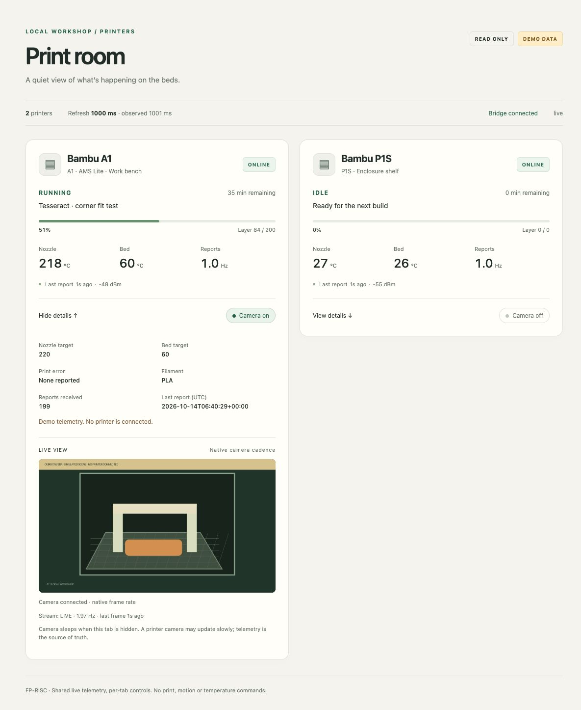

# Print room

A small read-only LAN printer dashboard. The application is
[../printers.fpr](../printers.fpr): a shared FP-RISC `std/live` model, typed
messages, per-browser expanded cards and camera switches, `std/view` trees,
and incremental WebSocket updates. It follows `pos1.fpr` and `inventory.fpr`.
The default Python transport handles Bambu MQTT/TLS and framed-JPEG cameras.
An opt-in FP-RISC collector now handles authenticated native TLS/MQTT and
telemetry projection. A separate opt-in native camera service handles framing,
sharing and MJPEG streaming; Python still serves login and gateway supervision.
JavaScript manages browser media lifecycle and local challenge signing; it does
not fetch/render printer status or own the dashboard model.

From the repository root:

```sh
./fpr build examples/printers.fpr -o build/printers
python3 -m venv /tmp/printer-dashboard-venv
/tmp/printer-dashboard-venv/bin/pip install -r tools/printer-dashboard-requirements.txt
/tmp/printer-dashboard-venv/bin/python tools/printer_dashboard.py --demo
```

Open [Print room](http://127.0.0.1:6730/) and sign in with an authorized key.
Demo mode requires the signature-verification dependency and an authorized
login key, but no physical printers. Both the telemetry and camera are explicitly
simulated; `demo-camera.jpg` is a generated illustration, not a printer photo.

## Public-key login

The public Ed25519 allowlist is `auth.json` beside this file (override with
`--auth=PATH`). The Mac and phone keys are registered there. The bridge reads
that single allowlist at startup and includes only its public entries in the
FP-RISC `Model.auth` field. Authentication is enforced by the gateway before
HTML, live WebSocket, status API or camera access; hiding a card is not an
authorization boundary. A missing or invalid allowlist prevents startup.

On the Mac, the generated private key is stored with mode 0600 at
`~/.config/fprisc/printer-dashboard/mac-ed25519.pem`. Copy it privately and
paste it into the login screen. Accepted formats are PKCS#8 PEM, a 32-byte
hex Ed25519 seed, or a 64-byte seed concatenated with its public key. This
last format is not a 64-byte expanded scalar key. Neither SSH-format nor
encrypted PEM keys are accepted. The browser imports a non-exportable signing
key, clears the input and sends only a challenge ID and signature. No key is
sent to the server, put in a URL, added to the live model, or saved in browser
storage. JavaScript memory is garbage-collected, so clearing a field is not
a guarantee of immediate memory erasure.

Challenges expire after 60 seconds, are one-use even on failure, and bind to
the origin and an HttpOnly browser cookie. There is a bounded challenge rate
and bounded in-memory state. Verified logins receive an eight-hour HttpOnly,
SameSite=Strict cookie (Secure on HTTPS). Sign out revokes that session;
already-open WebSockets and camera feeds check revocation while streaming.
Other tabs redirect to login on their next session check (up to 15 seconds).
Restarting the bridge expires all sessions. Change the public allowlist and
restart to add or revoke devices.

WebCrypto signing needs a current browser supporting Ed25519 and HTTPS, or
localhost. For the public proxy launch with
`--origin=https://3dprint.cswine.cloud`; the configured origin is used to
reject foreign Host/Origin headers and issue secure cookies. The existing
nginx IP restriction has been removed, so authorized devices can sign in
from any network. No third-party scripts load on the login page.

## Local printers

```sh
python3 -m venv /tmp/printer-dashboard-venv
/tmp/printer-dashboard-venv/bin/pip install -r tools/printer-dashboard-requirements.txt
cp examples/printer-dashboard/printers.example.json /tmp/my-printers.json
# Edit host, serial, name, location and model for each printer.
# Provide the named access-code variables in the process environment through
# your existing local secret mechanism. Do not put their values in this JSON.
/tmp/printer-dashboard-venv/bin/python tools/printer_dashboard.py --config=/tmp/my-printers.json
```

For the existing `3d-models/.env` layout, no separate JSON file is needed:

```sh
/tmp/printer-dashboard-venv/bin/python tools/printer_dashboard.py \
  --env-file=../3d-models/.env --printers=a1,p1s
```

The loader reads only `BAMBU_A1_HOST`, `BAMBU_A1_ACCESS_CODE`,
`BAMBU_P1S_HOST`, `BAMBU_P1S_ACCESS_CODE`, and optional matching `_SERIAL`
fields. It parses assignments without executing shell code, keeps access
codes only in the bridge's runtime environment, and strips them from the
FP-RISC child's environment. Missing serial IDs are discovered from LAN
advertisements from the configured hosts. Nothing is written back to `.env`.
`--printers=a1` skips the P1S completely; use `--printers=a1,p1s` when both
are powered on, or `--printers=p1s` for that printer alone. Discovery waits
up to 20 seconds; optional `BAMBU_A1_SERIAL` / `BAMBU_P1S_SERIAL` values
avoid waiting for advertisements on subsequent starts.

A1/P1-series MQTT status and port-6000 cameras use the same LAN protocol as
`../3d-models/bambu-lan/`. X1 RTSPS is not supported; set `camera` to `none`
for unsupported cameras. The A1 has been checked against the physical printer
(see validation below).
The P1S has also been verified against the physical printer and is now
enabled alongside the A1 (see the P1S validation below).
The bridge strips transport credential variables from the FP-RISC child’s
environment; no actual access code is needed by that process or the browser.
The public snapshot is an allowlist, not a copy of raw MQTT reports.

The default listener is loopback only. Use an HTTPS proxy and explicit
`--origin` for access from other devices. Printer TLS uses
self-signed certificates, with the same LAN-only trust assumption as the
existing scripts. No cloud or AWS services are involved.

## What the cards show

- State, job, progress, layers and estimated time remaining.
- Nozzle/bed temperatures and targets, Wi-Fi, filament and print error.
- Latest report age, MQTT connection state and measured report Hz (rolling
  30-second window; warms up during the first 30 seconds and decays to zero
  when messages stop).
- Camera stream state, measured frame Hz and last-frame age, so a stalled
  camera is not presented as a fresh image.
- Dashboard refresh target and actual interval, separately from printer Hz.
  `--poll-ms=1000` is the default (accepted range 250..10000).
- Expand a card for details. Switch its camera on for a same-origin MJPEG
  feed. The camera does not connect on page load. It suspends while the card
  is collapsed, the tab is hidden, or the dashboard is disconnected. Turning
  off/closing the final viewer closes that printer's camera socket. Multiple
  viewers share one upstream stream (max 8 per printer).

A printer is stale after 15 seconds without telemetry; a bridge snapshot is
stale after 5 seconds. Last-known data stays visible with a stale/offline label.
The dashboard never equates acceptance, PREPARE or RUNNING with a completed
physical print. Camera cadence is whatever the printer supplies; it is not
advertised as 30 fps. An unavailable camera says so and can be retried by
switching it off and on.

Only one status request (`pushall`) is published per MQTT subscription, including
reconnections. There are no pause/start/stop, temperature, G-code, upload or
slicing endpoints. Ordinary HTTP mutation methods are rejected; WebSocket
messages only change per-tab presentation state. Unknown printer IDs are ignored.

## Check

```sh
./fpr build examples/printers.fpr -o build/printers
/tmp/printer-dashboard-venv/bin/python tests/check_printer_dashboard.py
```

Checks delta merging, stale/offline states, missing AMS data, invalid numbers,
public field filtering, camera sharing and teardown, invalid configuration,
read-only HTTP routes, same-origin checks, real FP-RISC 1/4-hart sessions,
per-tab isolation, malformed/missing snapshot recovery, text escaping,
reconnection defaults, and the complete HTML/WebSocket gateway. Login checks
cover unauthenticated routes, browser WebCrypto signing in all three key
formats, unknown keys, consumed/expired challenges, origin/browser binding,
expiry, rate limits, logout, and closure of an established WebSocket. These
tests generate disposable keys and never read the real Mac private key.

No daemon is installed and nothing is published. Stopping the launcher stops
the private FP-RISC listener, MQTT connections, camera streams and temporary
snapshots. A print or motion test is outside this read-only dashboard’s scope.

## Preview and validation (2026-10-14)



The example builds with the current compiler. Nine transport checks and the
real FP-RISC wire checks (one and four harts) pass. The desktop (1200 px) and
phone (390 px) layouts were inspected in a browser without horizontal overflow.
An enabled demo stream stayed at one upstream connection across progress
changes and expansion of the other card; collapsing the camera card removed
its image request. No physical printers were accessed during these checks.

## Physical A1 validation (2026-10-14)

The dashboard was switched from demo mode to the real A1 using the existing
`3d-models/.env`, with `--printers=a1`. The P1S was powered off and explicitly
skipped during this initial A1 check. The subsequent P1S check is below.

- 45.1-second observation: 15 additional MQTT reports, all 16 sampled states
  ONLINE; real nozzle, bed and Wi-Fi values changed in the browser.
- Camera: real 1536-pixel-wide JPEG images, roughly 0.43 frames/second at the
  printer's native cadence, with one uninterrupted upstream connection.
- A concurrent second viewer received two valid JPEGs (142269 / 142555 bytes)
  without opening another connection to the printer.
- Switching the camera off reached zero viewers and OFF; enabling it again
  successfully reopened the feed.
- Neither the HTTP page nor the public status JSON contained either access
  code. Only runtime environment values were loaded; `.env` was not modified.
- Nine transport checks plus the one-/four-hart FP-RISC wire and gateway
  checks pass after the `.env` loader and printer-selection changes.

The printer reported FINISH for a previous job. This is observed telemetry,
not a new print or a physical quality verdict. No print, motion, temperature,
light or upload commands were sent. The only printer request was the initial
MQTT status snapshot. Sanitized measurement evidence is kept locally under
`build/printer-dashboard-live-check.json` (ignored by Git).

## HTTPS endpoint

The Linode now proxies [3dprint.cswine.cloud](https://3dprint.cswine.cloud/)
over Tailscale to this app. The login endpoint is available from any network;
printer data, WebSockets and cameras require public-key authentication. See
[proxy configuration and operational notes](../../deploy/printer-dashboard/README.md).
The host Mac must remain awake and running the dashboard.

## Authentication verified (2026-10-14)

Ten transport/auth checks, the one-/four-hart FP-RISC checks, and the complete
gateway checks pass. The exact client signing code was exercised with Node
WebCrypto using disposable PEM, seed and seed+public test keys. An actual
browser showed the live HTTPS login page and cleared invalid input without
submission. The real Mac key successfully signed into the HTTPS endpoint;
the verified session received fresh A1 reports, two camera JPEG frames and
a WebSocket 101 upgrade. Signing out closed that established WebSocket and
returned the status route to 401. Anonymous status, WebSocket and camera
requests all received 401. The phone public key is registered, but a login
using the phone's matching private key has not been performed.

Sanitized evidence: `build/printer-dashboard-auth-check.json` and
`build/printer-dashboard-login.jpg` (ignored by Git). The running bridge uses
`--env-file=../3d-models/.env --printers=a1,p1s --port=6730
--origin=https://3dprint.cswine.cloud`.

The nginx IP restriction was subsequently removed by user request. A source
previously receiving 403 now receives the login page and challenge endpoint
(200), while anonymous status, WebSocket and camera requests receive 401.
nginx configuration validation passed before reloading; its previous access
snippet is backed up under `/root/nginx-backups/` on the Linode.

## Physical P1S and two-printer validation (2026-10-14)

LAN discovery found the P1S at a different address from its saved `.env`
HOST. Read-only MQTT and two valid camera JPEGs were verified before
correcting only `BAMBU_P1S_HOST` and adding its discovered `_SERIAL` in the
existing local configuration. Access-code values were preserved without
being printed or put into a backup. The live launcher now selects
`--printers=a1,p1s` with the existing HTTPS origin and public-key allowlist.

Authenticated HTTPS validation showed both printer cards in the actual
FP-RISC WebSocket view and fresh reports from both printers over an
eight-second observation. The P1S camera switch updated its own live card;
its HTTPS feed supplied two valid JPEGs (63204 and 64717 bytes). At that
observation the P1S reported RUNNING, 41%, layer 51/126, 88 minutes remaining,
with no reported error. This describes telemetry, not a completed physical
print. Anonymous status and P1S camera requests still received 401. Restarting
the bridge expired earlier sessions, so existing users need to sign in again.
Sanitized evidence is in `build/printer-dashboard-two-printers-check.json`
(ignored by Git).


## Native telemetry (opt-in)

Build the collector with the optional OpenSSL 3 engine, and build the view:

```sh
./fpr build examples/printer-telemetry.fpr -o build/printer-telemetry \
  --with machine/unix/tls_openssl.c \
  --cflag -I/opt/homebrew/opt/openssl@3/include \
  --link -L/opt/homebrew/opt/openssl@3/lib --link -lssl --link -lcrypto
./fpr build examples/printers.fpr -o build/printers
```

Use a public configuration like `printers.example.json`, adding `tls_ca` (an
absolute path to a trusted CA PEM) and `tls_peer` (the certificate's verified
DNS/IP identity) to each printer. `mqtt_port` is optional, default 8883. The
host/serial and access-code environment-variable name still belong in that
configuration; the access-code value does not. Use `--config` for this mode;
the existing `.env` discovery launcher does not yet carry trust metadata.
Certificates must chain to the configured CA and satisfy identity/validity
checks. There is no insecure fallback. Establish the real printer's trust
material before selecting this mode; simulator acceptance does not establish
A1/P1S certificate compatibility.

With each code already supplied privately in the caller's runtime environment:

```sh
/path/to/dashboard-venv/bin/python tools/printer_dashboard.py \
  --config=/absolute/path/printers.json \
  --native-telemetry="$PWD/build/printer-telemetry"
```

Native mode needs `cryptography` for existing gateway login, but does not load
Paho. One native process owns each printer's DNS/TCP/TLS/MQTT, report merging,
projection, keepalive and reconnect. Only its selected code is passed to it,
through `FPR_PRINTER_CODE`, with no code in arguments, public output or the UI
process environment. The only publication is the existing read-only `pushall`
status request after subscribing, repeated after reconnect. Python remains for
supervision, HTTP/WebSocket/login, cameras and snapshot aggregation. This is
an opt-in migration; the live deployment is unchanged.

Verify without a printer or real credentials:

```sh
/path/to/dashboard-venv/bin/python tests/check_printer_native.py \
  --binary=build/printer-telemetry
python3 tests/check_native_services.py --broker \
  --openssl-prefix=/opt/homebrew/opt/openssl@3
```

The first check uses an isolated TLS printer simulator and the actual gateway
handoff on one/four harts. It covers authenticated subscription/status requests,
fragmented/coalesced delta reports, reconnect/resubscribe, private-field
exclusion, bad-password refusal and verified-peer rejection. The second also
uses pinned Mosquitto for authenticated QoS 1 and keepalive. Real printer trust,
telemetry and camera acceptance are still separate tasks.


## Native camera (opt-in)

Build the verified native camera service with the same OpenSSL 3 flags as the
telemetry collector:

```sh
./fpr build examples/printer-camera.fpr -o build/printer-camera \
  --with machine/unix/tls_openssl.c \
  --cflag -I/opt/homebrew/opt/openssl@3/include \
  --link -L/opt/homebrew/opt/openssl@3/lib --link -lssl --link -lcrypto
```

Add `--native-camera="$PWD/build/printer-camera"` to the `--config` gateway
launcher above. It can be selected independently of `--native-telemetry`.
Every printer requires explicit verified `tls_ca`/`tls_peer`. If camera and MQTT
certificates differ, add `camera_tls_ca` and `camera_tls_peer` overrides.
`camera_port` is optional, default 6000. Access-code values stay in the named
runtime environment variable. The camera protocol accepts at most 32 bytes;
it refuses empty, longer or embedded-NUL values. Native mode does not disable
TLS verification. Configure the actual device's trust before using this mode.

The first authenticated camera request starts a private local native service;
its first viewer starts one upstream TLS connection. FP-RISC owns camera login,
bounded JPEG records, one latest-frame cache, up to eight shared viewers,
MJPEG framing and per-viewer write deadlines. Final-viewer cleanup drops the
frame and closes upstream I/O, even during a stalled frame read. A retired
source cannot publish into the next viewing generation. The idle local service
remains available for later requests and stops with the gateway. Python retains
public login/session checks and process supervision, and relays the native HTTP
body without interpreting camera/JPEG/multipart framing. Logout and session
expiry continue to close active streams; browser hide/collapse behavior is
unchanged.

Test without a real camera or private code:

```sh
/path/to/dashboard-venv/bin/python tests/check_native_camera.py \
  --binary=build/printer-camera
```

The TLS simulator covers fragmented/consecutive frames, the exact 80-byte login,
shared viewers and capacity, final-viewer cleanup, new generations, malformed,
truncated, oversized and stalled records, identity rejection and slow clients.
It also exercises native multipart streaming through the authenticated gateway
and verifies that logout releases the upstream connection. This does not yet
establish real A1/P1S camera certificate/protocol compatibility.
